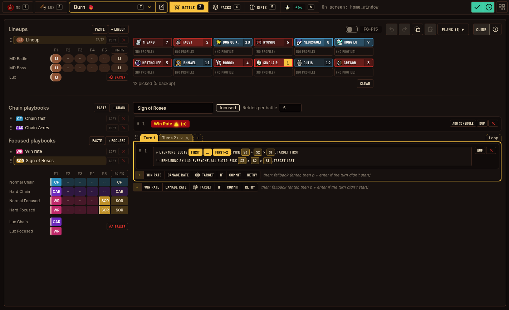
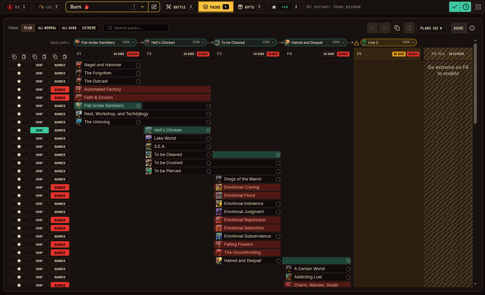
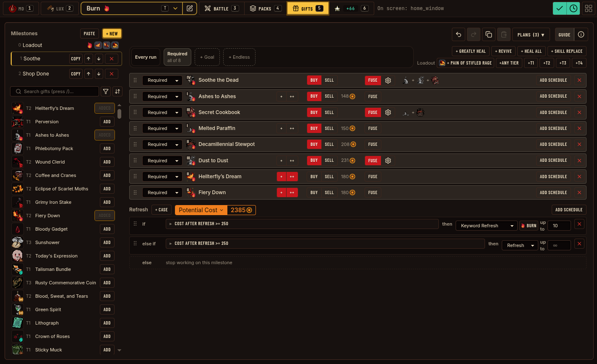

# Starlight

Automation for fast teams in limbus company.

Linux only for now. Windows support planned.





## Build

Elixir + Rust required.
```
git clone --recursive https://github.com/soamsy/starlight.git
mix deps.get
mix compile        # compiles Rust NIF — slow on first run (~30–60s)
mix phx.server     # starts at localhost:4000
```

## Desktop app (Tauri)

`src-tauri/` wraps the Phoenix app in a Tauri window using [ElixirKit](https://elixirkit.hexdocs.pm/tauri.html). Needs `cargo-tauri` (`cargo install tauri-cli`) and webkit2gtk-4.1.

```sh
cd src-tauri
cargo tauri dev
env NO_STRIP=true cargo tauri build      # prod release + AppImage in src-tauri/target/release/bundle/appimage/
```

## Other commands

| Command | Description |
|---------|-------------|
| `mix db.setup` | Create (if not created yet) and migrate the base, user and runs databases |
| `mix db.migrate` | Just run pending migrations on all three databases |
| `mix assets.build` | Build starlight_bot CSS/JS assets |
